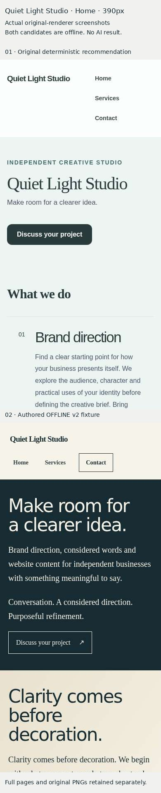

# Quiet Light Studio — genuine offline comparison evidence

Source **21121ee462b27a77b30089ba69e2adcb28d15182**, tree **333730364aa97026a7b897c8ccf9e626432d3c2b**. Chromium **145.0.7632.6**, original Website Builder and renderer, sandbox required, no external browser requests. **No genuine model result exists.** Candidate01 is the frozen current deterministic recommendation;02 is a manually authored v2 engineering fixture. This is neither a temporal before/after nor an isolated test of AI judgement. Facts and source identity are identical; expressive output contracts differ.

The [browser run](https://github.com/7774cg5t75-cloud/busy-does-it-app/actions/runs/42297957555) passed **742/742** objective checks, with24 full-page PNGs,12 actual navigation checks and zero image requests. Viewports:320×844,390×844,1440×1000 and390×844 atDPR2. All three pages of both candidates were captured. Technical results are not professional visual acceptance, hosted readiness, WCAG certification or owner approval.

- [Original iPhone pack](https://github.com/7774cg5t75-cloud/busy-does-it-app/actions/runs/42297957555/artifacts/13541484922): compact JPEGs, three comparisons and index; download while retained.
- [Complete original evidence](https://github.com/7774cg5t75-cloud/busy-does-it-app/actions/runs/42297957555/artifacts/13541934421): full-resolution PNGs, original generated HTML, source/input/schema/wire identities, browser metrics and local readback/export evidence.
- [Professional pixel critique](visual-review.md), [exact browser/pixel receipts](browser-evidence.json), [derived comparison checksums](comparison-sheets.json).
- [Exact fictional input and request inventory](proposal-inputs.json): [approved synthetic facts](approved-synthetic-input.json), [strict schema](strict-response-schema.json), [complete disabled request](complete-disabled-request.json), [authored offline response](authored-offline-response.json), [frozen original deterministic proposal](frozen-deterministic-proposal.json). Canonical digests exclude the final file newline; both canonical and raw file hashes are recorded. No hosted identity, execution approval, credential or genuine provider response is included.
- [Final CI receipts](ci-results.json) and [failed/superseded run history](ci-run-history.json) distinguish exact push checkouts from supplementary PR merge checks.

The original Actions archives expire **13November2026** under the reviewed seven-day retention. The twelve checksum-verified full-page JPEG derivatives and three phone sheets below persist in Git. They do not replace the full-resolution PNG originals. The JPEG receipt manifest records each original PNG identity, source viewport and aspect-preserving conversion; the phone sheets stack unchanged390px first-screen crops with evidence labels. No invented/reflowed website pixels or AI image generation were used.

| Page | Candidate01: full pages | Candidate02: full pages | Phone comparison |
|---|---|---|---|
| Home | [Mobile](review-candidate-01-home-mobile.jpg) · [Desktop](review-candidate-01-home-desktop.jpg) | [Mobile](review-candidate-02-home-mobile.jpg) · [Desktop](review-candidate-02-home-desktop.jpg) | [390px](home-iphone-comparison.jpg) |
| Services | [Mobile](review-candidate-01-services-mobile.jpg) · [Desktop](review-candidate-01-services-desktop.jpg) | [Mobile](review-candidate-02-services-mobile.jpg) · [Desktop](review-candidate-02-services-desktop.jpg) | [390px](services-iphone-comparison.jpg) |
| Contact | [Mobile](review-candidate-01-contact-mobile.jpg) · [Desktop](review-candidate-01-contact-desktop.jpg) | [Mobile](review-candidate-02-contact-mobile.jpg) · [Desktop](review-candidate-02-contact-desktop.jpg) | [390px](contact-iphone-comparison.jpg) |

[Local review index](index.html) is only an index of these actual screenshots; it is not a generated business website or a second builder.

The original Studio tests exercise one-use local Keep, exact private readback, duplicate/unknown-outcome denial, scoped Undo/Redo and portable three-page exports. They are not hosted Auth/account-save evidence. Provider calls, inference spending, hosted writes, publication and approved Gold Standards are all zero in this mission.
