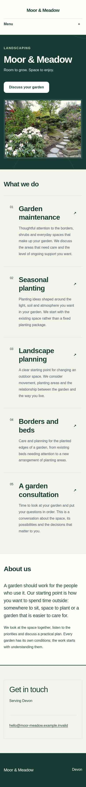
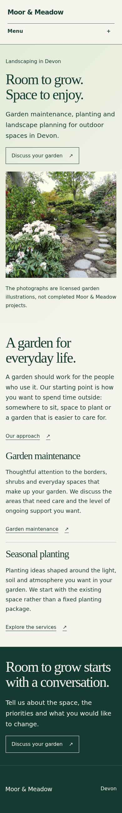
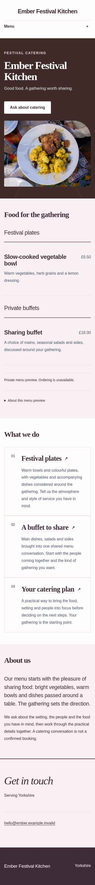
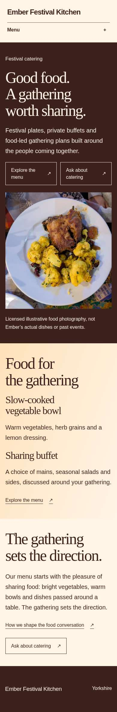
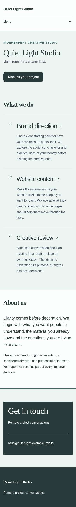
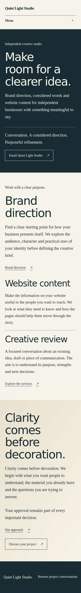
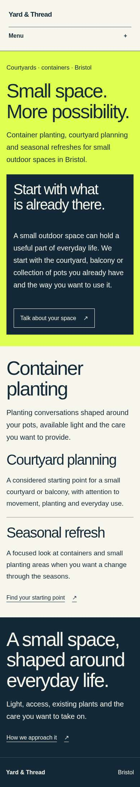

# Mission19 — real website review

Four fictional businesses, built and rendered through the original Website Builder. These are genuine browser screenshots of working implementation, using explicitly authored **offline response fixtures**. They are not AI mock-ups or real-model results.

The three existing businesses retain the same approved fictional facts and licensed assets in their before/after comparison. Visible writing, page architecture and design may change: this is **not a pure CSS-only comparison**. Yard & Thread is a new independently scoped gardening business and is after-only. Illustrative photographs are not evidence of these businesses' actual dishes, premises or completed work.

Open a business below to view its complete phone Home page vertically, before then after. Tap an image to inspect it. Desktop and important internal-page links follow each pair.

[Full phone-friendly review pack — 85 files, 64 JPEGs and 18 comparisons](https://github.com/7774cg5t75-cloud/busy-does-it-app/actions/runs/42280268183/artifacts/13534338632) · [Full-resolution original PNGs, HTML and technical evidence](https://github.com/7774cg5t75-cloud/busy-does-it-app/actions/runs/42280268183/artifacts/13534878238) · [Detailed professional critique](VISUAL_REVIEW.md) · [Exact hashes and provenance](pixels.json)

## The three main examples

<strong>Moor &amp; Meadow — landscaping, five pages</strong>

**Before — Mission18 reviewed offline fixture, phone390×844.**

**After — Mission19 expressive offline proposal, phone390×844.**

[Home desktop](review-moor-meadow-home-after-desktop.jpg)

- Garden maintenance: [before phone](review-moor-meadow-page-garden-maintenance-before-mobile.jpg), [after phone](review-moor-meadow-page-garden-maintenance-after-mobile.jpg), [after desktop](review-moor-meadow-page-garden-maintenance-after-desktop.jpg).
- Our approach: [before phone](review-moor-meadow-about-before-mobile.jpg), [after phone](review-moor-meadow-about-after-mobile.jpg), [after desktop](review-moor-meadow-about-after-desktop.jpg).
- Contact: [phone](review-moor-meadow-contact-after-mobile.jpg), [desktop](review-moor-meadow-contact-after-desktop.jpg).

The viewed routes support a professional private preview. The maintenance page remains comparatively ordinary, and the public-garden illustrations cannot establish Devon project experience. The Services index is in the full artifact, outside this compressed subset.

<strong>Ember Festival Kitchen — catering, four pages</strong>

**Before — Mission18 reviewed offline fixture, phone390×844.**

**After — Mission19 expressive offline proposal, phone390×844.**

[Home desktop](review-ember-home-after-desktop.jpg)

- Menu: [before phone](review-ember-products-before-mobile.jpg), [after phone](review-ember-products-after-mobile.jpg), [after desktop](review-ember-products-after-desktop.jpg).
- The gathering: [before phone](review-ember-about-before-mobile.jpg), [after phone](review-ember-about-after-mobile.jpg), [after desktop](review-ember-about-after-desktop.jpg).
- Catering enquiry: [phone](review-ember-contact-after-mobile.jpg), [desktop](review-ember-contact-after-desktop.jpg).

This example needs further design improvement. The menu and enquiry journey are clearer, but the casual illustrative plates do not convincingly tell the supplied festival/vegetable-menu story. Their truthful captions do not resolve that art-direction weakness.

<strong>Quiet Light Studio — image-free creative business, five pages</strong>

**Before — Mission18 reviewed offline fixture, phone390×844.**

**After — Mission19 expressive offline proposal, phone390×844.**

[Home desktop](review-quiet-light-home-after-desktop.jpg)

- Brand direction: [before phone](review-quiet-light-page-brand-direction-before-mobile.jpg), [after phone](review-quiet-light-page-brand-direction-after-mobile.jpg), [after desktop](review-quiet-light-page-brand-direction-after-desktop.jpg).
- A clear approach: [before phone](review-quiet-light-about-before-mobile.jpg), [after phone](review-quiet-light-about-after-mobile.jpg), [after desktop](review-quiet-light-about-after-desktop.jpg).
- Project conversation: [phone](review-quiet-light-contact-after-mobile.jpg), [desktop](review-quiet-light-contact-after-desktop.jpg).

The viewed routes support a professional private preview. The deliberate image-free identity and supplied process are stronger, but mobile headline wrapping and the repeated two-part service-page structure still need finesse. The Services index is in the full artifact, outside this compressed subset.

## Same-industry individuality

<strong>Yard &amp; Thread — image-free small-space gardening, four pages; after-only</strong>

**After only — no previous-business screenshot is presented as a baseline. Phone390×844.**

[Home desktop](review-yard-thread-home-after-desktop.jpg) · [Services phone](review-yard-thread-services-after-mobile.jpg)

Compare its bold chartreuse/navy typography, inset opening and alternating service bands with Moor & Meadow's calm photographic hierarchy. The difference extends beyond changing a name, colour or photograph.

Home and Services support a professional private preview, without reaching an exceptional commissioned standard. The bright palette is taste-dependent, and the service bands are still repetitive. About and Contact are captured in the full artifact but are not in this compressed subset; no aesthetic acceptance is claimed for those routes.

## What this evidence establishes

Fresh browser run [42280268183](https://github.com/7774cg5t75-cloud/busy-does-it-app/actions/runs/42280268183), job128107119521, rendered functional source [f42028950b573ceee874994e5414763423abc5d4](https://github.com/7774cg5t75-cloud/busy-does-it-app/commit/f42028950b573ceee874994e5414763423abc5d4), tree `5c5cc5af6656306cf979f4cf70892f89e2f16691`, with a clean source snapshot and Chromium145.0.7632.6.

The run retained160 full-page PNGs across18 after pages and the matched before pages, plus four open-Menu PNGs. It reported72 actual typography checks,64 actual navigation checks and zero after-stage failures. Technical captures cover320px and390px mobile,768px tablet,1440px desktop and390px DPR2 mobile where selected. These technical results do not grant professional visual acceptance, owner acceptance, Gold Standard status or release readiness. Application, database, Edge, security and legacy workflow results are reported separately.

This directory deliberately retains only36 bounded complete-page JPEG receipts, totalling1,990,357 bytes. The professional critique inspected27 after images from that subset, not every captured route. Desktop JPEGs are reduced from1440px to720px; phone receipts retain their recorded width. Compression and scaling are disclosed per image in [pixels.json](pixels.json), alongside each original PNG hash, JPEG hash, viewport and source identity. They are not replacements for the original full-resolution PNGs.

The decoded JPEG receipts came from the earlier unchanged-renderer source64628aecdec30a8e59edd3fcf9471543999ba031. Every copied JPEG digest and its original PNG digest was independently verified against the fresh final-source f420 rendering metadata. That proves pixel continuity for these36 receipts, not for every full-artifact image.

The wider phone artifact is5,444,643 bytes and contains an offline viewer. Its internal ZIP is6,118,739 bytes, SHA256 `2b28f23e18969db737762fe6bdc3e5425a693f56b0a011edc4412424bfb6e37c`. The full originals artifact is76,300,993 bytes. Both CI artifacts have seven-day retention from upload; download them within that window for longer private retention. No duplicate ZIP is committed here.

The collection remains at **three existing candidates and zero approved Gold Standards**. These fixtures demonstrate what the expanded builder can express. They do not prove real-model superiority, consistent exceptional design, completed launch entitlements or paid website economics. No provider call, publication or hosted acceptance is represented by this evidence viewer.
